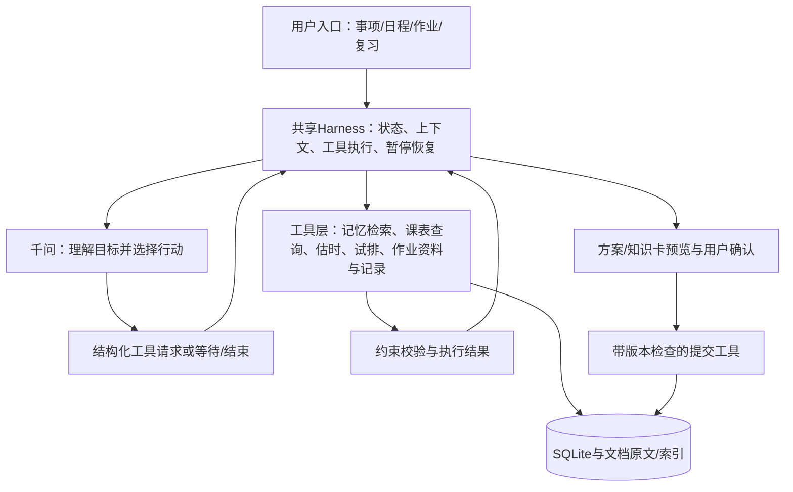

# 随手计划：个人学习规划 Agent 与作业帮助助手改进方案

> 本文为完整目标方案，非全部已实现。当前开发进度与实际接口见[阶段1](阶段1_实现与验证.md)、[阶段2](阶段2_实现与验证.md)、[阶段3](阶段3_实现与验证.md)、[阶段4](阶段4_实现与验证.md)、[阶段5](阶段5_实现与验证.md)和[阶段6](阶段6_实现与验证.md)；共享作业桥接以[接入契约v1](共享场景接入契约_v1.md)为准，其中尚未实现的功能仍按后续范围处理。

编制日期：2026-11-04；修订日期：2026-11-05（v0.5方案，明确内部工具调用与SQLite访问流程）  
适用项目：大模型智能体基础与应用课程项目“随手计划”  
团队：孔传、王浩宇、罗德金  
文档状态：开发前方案；所有新增功能、数据结构和算法均为拟议内容，不代表已经实现。  
本轮工作边界：整理方案，不修改源代码、构建产物、现有数据库和报告/PPT。

## 1. 目标与一周范围

保留现有0.1作为可运行基础和对照版本，将“自然语言输入—任务提取—按天分配”的固定工作流升级为有状态的个人学习规划Agent，并增加作业帮助与原题复习场景。

> 用户目标 → 模型选择行动 → Harness执行检索、澄清或规划工具 → 返回真实结果 → 模型选择下一步 → 校验与用户确认 → 保存 → 执行/学习反馈进入后续运行。

核心贡献包括运行循环、相关记忆装载、交互暂停恢复、工具执行与反馈，以及个人耗时校准、约束调度和学习记录管理。模型可以判断是否追问、检索什么、如何拆分目标、提出哪些候选安排，并在工具失败后调整行动。程序负责计算、约束校验、持久化和执行边界。不是把每种业务路径全部写死，也不是给模型任意数据库/文件访问权限。

本轮用户明确的责任划分：孔传负责0.1已有基础的梳理和交付；王浩宇负责提出的个人规划Agent、Harness、记忆与调度改进；罗德金负责作业帮助助手。报告讲述与实际开发贡献分别记录；孔传的0.1部分可本人讲，也可由王浩宇代讲，最终上台安排尚待确定。

### 1.1 交付优先级

| 优先级 | 功能 | 答辩前验收目标 |
|---|---|---|
| P0 | 修复今日页、自动重评锁定、日期语义问题 | 软件正常使用，人工修改与自动更新分开 |
| P0 | Agent运行循环、工具协议、行动记录 | 模型依据实际工具结果继续行动，不是一次参数提取 |
| P0 | 添加事项/完成任务时按需澄清 | 模型可直接继续、查询或请求澄清；等待回答后可恢复 |
| P0 | 今日对话与完成后的后台反馈 | 完成先落库，后台按需生成消息；对话可查询/调整任务且有结构化操作结果 |
| P0 | 相关记忆检索、来源与时效管理 | 按当前目标检索，能够纠正过期/矛盾记录 |
| P0 | 课表、作息、固定事件、今日例外 | 能准确计算未来7天可用时段 |
| P0 | 截止时间与执行时段分离 | 改期不改变外部截止要求 |
| P0 | 具体时段调度、解释与未安排提示 | 无课程/任务重叠，无法满足时明确展示 |
| P0 | 完成耗时反馈、任务操作记录、基础统计 | 可追溯执行过程，统计口径一致 |
| P1 | 简化个人耗时校准 | 数据充足后修正同类任务估时 |
| P0 | 作业帮助最小闭环 | 文字题目、提示/讲解、保存知识卡、原题重做 |
| P1 | OCR图片录入与公式校对 | 作业截图/清晰印刷题照片→可编辑识别稿→用户确认→问答/保存；纳入明确开发范围 |
| P1 | 作业结果生成复习任务 | 用户确认后形成任务，经规划工具安排；不因一次作答永久修改画像 |
| P1 | 课程资料/错题的RAG与引用 | 少量可信资料可检索、可追溯；向量检索不是P0前提 |
| P1 | 软件运行期间提醒、托盘 | 提醒去重，关闭窗口后可选择继续运行 |
| P1 | 当日轻量计划、局部重排 | 不随意移动已确认的无关任务 |
| P1 | 每日时间轴、周时间表与主动检查 | 今日横向时间轴，日程七列时间网格；按事件去重检查课后待办和计划风险 |
| P2 | 真实邮件收件箱 | 授权后只读接入，邮件转任务需预览、去重与确认 |
| P2 | 开机启动、桌面小组件、手机端 | 主流程稳定后再排期 |
| P2 | 健康平台接入、天气、通用任务指导、完整题库 | 本周不列为必交成果，作业帮助按独立范围实现 |

P0是目标版本的完成门槛；优先打通一次跨模块闭环。王浩宇范围较大，优先运行循环、检索、基本试排与校验，统计先卡片而非复杂图表。小样本反馈只用于机制演示，不能证明长期个性化效果。P0无法完成时明确标记原型范围，不将计划功能写成已实现。

### 1.2 术语与判定依据

- 0.1 Workflow：程序固定调用LLM提取参数，再交给程序排序/按天分配。具有模型能力，不据此称为自主Agent。
- Agent：在本课程讨论的LLM Agent语境下，根据目标、状态和工具返回结果，选择后续行动；有完成、等待用户、取消和无法继续等出口。
- Harness：运行模型/工具循环、上下文组织、工具分发与校验、状态保存、暂停恢复和日志等机制；最小版本不要求大型框架。
- Function calling：模型提出结构化工具请求的机制，真正执行由程序完成；一次调用本身不足以证明Agent。
- ReAct：推理与行动交替、利用观察调整后续行动的方法；本项目采用类似行动/观察循环，不强制输出内部思维链。
- RAG：针对当前目标检索资料，交给模型作为生成依据；向量检索是可选检索方式，MD是存储格式，两者可以结合。
- 原创工作：团队完成的场景设计、工程实现和实证验证；不把常用算法/模式宣称成首创学术成果。

参考定义：[Anthropic的Workflow/Agent区分](https://www.anthropic.com/engineering/building-effective-agents)、[Harness职责](https://developers.cloudflare.com/agents/harnesses/)、[ReAct论文](https://arxiv.org/abs/2210.03629)。具体课程评价仍对照教师标准，不仅靠命名判断。

## 2. 现状核对与必须处理的问题

本节依据当前项目源文件与现有构建文件的检查；运行效果仍需开发时逐项复现。

| 位置 | 当前行为/问题 | 拟改动与验证 |
|---|---|---|
| `src/shared/priority.ts` | `isOverdue()`使用未定义的`dueAt`；构建文件同样存在 | 改为任务字段，带截止时间任务进入今日页不再报错 |
| `src/renderer/src/views/TodayView.vue` | 从全部pending任务取优先级Top8，不是严格的今日执行计划 | 今日时段列表为主；未安排高优先级任务单列，不再混用 |
| `src/renderer/src/views/StatsView.vue` | 只有进行中、累计完成，图表为占位 | 接入有明确分母的统计及空数据状态 |
| `src/main/ai/scheduler.ts` | 固定240分钟软上限，按天写入23:59；范围末尾可回卷 | 改为真实空闲时段；无解返回未安排，不回卷破坏先后关系 |
| `src/main/db/taskDao.ts` | `dueAt`兼用于截止和调度；延期会改动该字段 | 保存外部截止与计划时段两套数据，增加来源标记 |
| `analyzer.ts`与`taskDao.ts` | AI每日重评调用通用updateTask，后者会设置人工锁定 | 分开人工更新和自动更新入口，自动重评不得触发人工锁定 |
| `src/main/ai/batch.ts` | 规则按行拆分，可能将“@所有人”等当作任务 | 过滤明确的称呼/空行；导入预览可删除；不将整批导入自动等同严格依赖 |
| 提醒相关设置 | 存在通知字段，但未见主进程提醒执行服务 | 实现扫描、去重、点击跳转，不能仅凭开关宣称已完成 |

其他日期边界（跨月、跨年、过期任务）在验证中集中检查。重排提示由“重新分配”调整为“重新安排计划”，展示前后变化并允许确认。

## 3. 产品流程与功能设计

### 3.0 技术架构与控制权



图中的循环为模型选择行动→工具执行→观察结果，不代表无限重试。工具内部可以是固定Workflow或纯算法。王浩宇负责共享Harness和规划工具，罗德金负责作业域工具/界面，孔传提供0.1基础和接口说明。第一版共享一个运行内核、按场景提供不同工具集合，不先宣称实现了多Agent协作。

| 层次 | 负责的决定 | 不能混淆的边界 |
|---|---|---|
| 模型策略层 | 是否查记忆/追问、查询条件、任务拆分、候选安排、试排失败后下一步 | 不直接执行SQL、不绕过工具校验 |
| Harness | 当前可用工具、上下文装载、会话状态、执行/等待/停止、轮数与时间预算 | 不用固定业务脚本预先代替所有模型选择 |
| 工具与算法 | 估时、空档、候选排序、硬约束、知识检索和统计 | 不必依赖模型进行精确算时 |
| 用户 | 确认目标、外部截止、长期记忆、计划提交和复习任务 | 正常查看和只读查询不重复要求确认 |

#### 运行内核与状态

Run状态：running、waiting_user、awaiting_confirmation、completed、blocked、cancelled、failed。每个Run有目标、入口场景、会话ID、输入数据版本、事件序号与预算；状态存库，重开后能恢复等待。blocked表示缺用户信息或约束下无法推进，不是自动当成成功结束。

默认每次连续运行最多6轮模型决策、12次工具调用、120秒总预算，均为初始工程参数；等待用户不计入运行耗时，恢复按新执行片段计算预算，总会话仍设上限。API超时单独配置；达到上限保留结果并说明停止原因。相同失败请求最多额外尝试一次，收到新信息/不同参数后才允许继续。

```text
startOrResume(goal, runId):
  loadRunAndCurrentDataVersion()
  while budgetAvailable:
    context = assembleInstructionsGoalRecentEventsAndRetrievedEvidence()
    decision = callModel(context, allowedToolSchemas)
    if decision requests tool:
      validateNameArgumentsAndPermission()
      result = executeToolOrReturnStructuredError()
      appendActionAndObservation(result)
      continue
    if decision asks user:
      persistQuestionAndState(waiting_user); return
    if decision proposes commit:
      showValidatedPreview(); persist(awaiting_confirmation); return
    if decision finishes:
      checkArtifactAndGoalCompletion(); persistResultOrMissingItems(); return
  persistBudgetStopWithPartialResult()
```

模型输出通过JSON Schema或function calling解析；若当前接口能力不足，可使用结构化JSON动作协议实现同样的运行循环，不能把未接通的tool calling写成已接通。完成判断由目标对应产物/状态核实，不能仅凭模型说“已保存”。日志记录行动、参数摘要、工具结果和停止原因，不索取或存储模型内部思维链。

#### 最小工具协议

统一返回：`ok/data/errorCode/message/sourceRefs/stateVersion`；只读工具无副作用，写入工具带幂等键和确认凭据。模型参数是提议，时间和数据最终以程序检查为准。

| 工具 | 输入与输出 | 归属/执行要求 |
|---|---|---|
| search_memory | query、scope、limit → 相关事实/片段、来源、时间、确认状态 | 王浩宇；只读、限定本用户与相关场景 |
| get_calendar / get_plan | 时间范围 → 课程、固定事件、已安排块、版本 | 王浩宇；精确查询，不用向量猜日期 |
| inspect_task_gaps | 草案 → 缺项、矛盾及其影响证据 | 王浩宇；提供证据，不自动决定所有追问 |
| estimate_duration | 基础估时、学科 → 校准估时、样本数 | 王浩宇；调用算法B |
| preview_plan | 任务草案、窗口、候选/偏好 → 可行块、冲突、未安排原因 | 王浩宇；只读试算，支持算法C |
| validate_plan | 模型提出或工具生成的计划 → 约束逐项结果 | 王浩宇；提交前必过 |
| ask_user | 问题、选项、所需字段 → 等待状态 | 王浩宇；每轮最多两个问题，允许跳过非关键项 |
| propose_memory / commit_plan | 候选事实/计划 → 预览；确认后提交版本 | 王浩宇；写入受控，不开放任意文件/SQL |
| update_task / reschedule_task | taskId、允许字段补丁/目标时段、expectedVersion → 旧新值、实际影响、撤销标识 | 王浩宇；显式用户指令可授权简单修改，跨任务/截止变更按预览规则处理 |
| publish_followup / finish_silently | 事件、问题/建议及证据或静默结果 → 消息ID/无消息 | 王浩宇；后台运行专用，过期检查、去重、提醒偏好校验 |
| search_study_material | query、课程、题目范围 → 片段及来源 | 罗德金；共享检索机制，分离学习资料集合 |
| get_problem / get_review_history | 题目ID → 题干、学生作答、复习记录 | 罗德金；遵守原题重做时答案隐藏规则 |
| recognize_image | 本机已上传imageId、purpose → 识别文本、LaTeX、待核对位置、图形提示、版本 | 罗德金实现；王浩宇接入工具注册/等待恢复；不是任意路径读取工具 |
| save_study_card / record_review | 已确认内容 → 卡片/复习记录ID | 罗德金；幂等保存，来源可追溯 |
| propose_review_tasks | 学习证据 → 复习任务草案 | 罗德金产生；王浩宇接入统一确认/规划接口 |

检索内容、题目、文档和旧对话都是数据，不能授权新工具、改变系统规则或自行提交计划。缺凭据/无权限时返回错误，不让模型用其他工具绕过。

#### 技术决策：直接调用内部工具函数，首版不接入MCP

已按用户2026-11-05决定：首版使用TypeScript内部工具函数与注册表，不部署MCP Server、不安装SQLite MCP服务、不要求模型服务直接连接本机数据库。MCP是工具等能力的标准接入协议，不是Function Calling的必要前提，也不是Agent成立条件。后续确需将同一能力提供给其他客户端时，再评估增加MCP适配层，领域函数保持可复用。

选择理由：当前是本机Electron应用，主进程已经可以通过better-sqlite3操作本机SQLite；直接复用现有数据访问层，减少进程、连接配置和部署环节。代价是工具协议、Schema、错误处理、调用循环由团队实现维护。这里复用现有库和模型，不宣称自研数据库或大模型。

| 概念 | 在项目里的具体作用 | 与其他概念的关系 |
|---|---|---|
| SQLite | 保存本机任务、课表、会话和学习记录的数据库 | 不是模型、检索算法或通信协议 |
| better-sqlite3 | Electron主进程内操作SQLite的Node库 | 由DAO使用，模型不可直接操作它 |
| DAO（数据访问层） | 封装查询、更新、事务，例如taskDao | 由业务服务/工具处理函数调用，不暴露任意SQL |
| Function Calling | 模型返回工具名称、结构化参数和调用ID | 只表达请求，实际执行在本机Harness |
| JSON Schema | 描述工具参数类型、必填项和允许字段 | 给模型看，也必须在本机进行运行时校验 |
| Harness/注册表 | 根据白名单找到函数，校验后执行并回传结果 | 接通模型与领域工具，管理运行状态 |
| Electron IPC / preload | Vue页面与主进程通信的桥梁 | 与模型Function Calling是两条不同的通信路径 |
| MCP | 可选的标准化工具接入协议 | 本版不使用，不影响内部函数作为Agent工具 |

#### Electron中的部署位置

```text
Vue今日/作业页面
  → preload暴露的窄接口（如startRun）
  → Electron IPC
  → 主进程Harness
      ↔ 云端模型API（发送允许的上下文、工具描述，接收行动请求）
      → 工具注册表/参数校验
      → 业务服务/调度算法
      → DAO
      → better-sqlite3
      → 本机SQLite文件
  ← 主进程广播/运行事件 → 页面更新
```

数据库连接和模型调用统一由主进程侧管理；渲染页面不拿数据库句柄，不提供通用SQL IPC。主进程内部执行工具时直接调用业务函数/DAO，无需绕回页面再走一次IPC，也没有HTTP请求直接从云端进入本机。云端模型只收到程序选取并发送的内容和工具结果，不天然看见整个数据库。

#### 具体调用流程：查询与改期

下面所有名称、JSON与version字段是拟议接口示例，不表示当前0.1已经具备这些能力。示例日期用于说明，不是实际用户计划。

1. 用户在今日说“把报告初稿安排到明天下午”；页面附当前选中任务ID（若有），通过preload/IPC创建Run。
2. Harness装载目标、当前时间/时区、最近必要消息、可用工具Schema；权限/确认状态来自应用可信状态，不由模型参数自行声明。
3. 模型输出如`get_plan({date:"2026-11-06"})`或先请求查询任务；Harness查注册表，检查工具名、类型、日期范围、返回条数上限和当前场景权限。
4. 对应处理函数调用计划服务/DAO；DAO使用参数化SQL读取SQLite，把任务/占用时段等必要数据变为普通JSON返回。不存在/无数据/数据库忙分别处理，不一律返回空数组。
5. Harness记录toolCallId与结果，将结果作为工具观察回传模型；模型据此提出14:00—15:30候选，并调用试排/校验工具。存在歧义或冲突时可查询更多信息或询问用户。
6. 需要改动多个任务/外部截止时先预览；用户明确授权的唯一任务简单改期，按3.6节规则校验后可直接提交。模型不能用参数`confirmed:true`伪造用户确认。
7. 写入工具提交前在短事务里重读任务和计划版本、重新检查冲突，版本过期返回`VERSION_CONFLICT`，由模型重查或询问；校验通过后同时更新计划块、写操作事件/撤销信息和提醒版本，保留外部截止。
8. 事务成功后广播变更，今日横轴、周表和任务列表刷新；工具返回实际旧新值和新版本。模型根据真实结果回复。若后续生成回复失败，修改仍真实存在，界面应显示结构化操作结果，不能重复写一遍。

拟议请求/结果示例：

```json
{
  "toolCallId": "call_example_01",
  "name": "reschedule_task",
  "arguments": {
    "taskId": 42,
    "startAt": "2026-11-06T14:00:00+08:00",
    "endAt": "2026-11-06T15:30:00+08:00",
    "expectedVersion": 7
  }
}
```

```json
{
  "ok": true,
  "data": {
    "taskId": 42,
    "startAt": "2026-11-06T14:00:00+08:00",
    "endAt": "2026-11-06T15:30:00+08:00",
    "deadlineChanged": false,
    "stateVersion": 8
  },
  "errorCode": null,
  "message": "计划已更新，截止时间未改变",
  "sourceRefs": ["task:42"],
  "stateVersion": 8
}
```

模型接口原生Tool Calling中，上述逻辑请求会按具体API映射成assistant工具请求及关联调用ID的tool结果消息；不能把示例JSON直接当成所有API通用的线格式。结构化JSON动作回退路径也使用同一注册表、校验、执行和结果回传，不因换输出格式省略控制。

#### 注册表、校验与写入机制

拟新增注册表维护`name/description/inputSchema/handler/readOrWrite/allowedScenes`。运行时仅按预注册名称查找处理函数，未知工具返回`UNKNOWN_TOOL`；不使用eval，不通过模型提供的字符串动态导入模块。类型声明只能帮助开发，不能替代解析外部JSON后的运行时校验。

读工具限定查询范围/条数，投影必要字段；任务查询不返回API Key等设置。工具名称、表/列名来自白名单，用户值用`prepare(...).get/all/run(params)`绑定；不能拼接模型给的SQL，也不能误以为参数绑定会自动校验业务规则。

写工具依次检查：参数→明确目标→调用场景和可信授权→当前版本/约束→短事务提交。授权确认后仍需在真正提交时检查版本。只读工具可按独立性并行；同一计划的写入按序执行并检查版本，不能让两个后台Run互相覆盖。

外部模型请求/等待用户时不持有数据库事务。事务仅包含本地检查与写入；部分写入失败整体回滚。现有WAL改善读写并发，但SQLite仍需处理写锁与忙错误，不代表多个写入可无限并发。短暂数据库忙采用有限重试，超过预算返回`DB_BUSY`；权限、缺字段和版本冲突不能简单循环重试。

幂等键由应用根据Run/调用或事件生成并保存；提交结果与幂等记录在同一事务，重复到达返回既有结果。HTTP超时与模型重试不应导致计划/知识卡重复创建。执行后网络中断时优先读取事件确认状态，而非无条件重放。撤销是带版本检查的反向操作，不直接覆盖用户之后的修改。

#### 0.1现有实现与后续开发差距

2026-11-05只读核对：`src/main/db/database.ts`已通过better-sqlite3连接`app.getPath('userData')/plan.db`，启用WAL和外键；`taskDao.ts`封装任务操作；`ipc.ts`注册界面处理器；`preload/index.ts`通过contextBridge提供`window.api`。

`src/main/ai/client.ts`当前`chatCompletion()`仅返回消息文本，`ChatMessage`只有role/content，尚未暴露原生tool_calls、调用ID和工具结果消息。因此不能只写几个函数就宣称Function Calling已接通。后续需扩展客户端请求/响应与消息类型、建立注册表和调用循环，并验证所选千问型号/端点的工具支持；不支持时采用已说明的JSON动作适配，明确标记实际实现方式。

新增逻辑建议放`src/main/agent`与领域服务中；复用DAO前检查0.1的人工锁、dueAt混用等副作用，不把现有IPC处理器全部直接当Agent工具。王浩宇维护协议和共享工具；罗德金按同一约定实现作业/OCR工具；孔传解释0.1数据链路和既有行为。

### 3.1 初次设置与每日输入

初次必填仅包含：可安排任务的作息区间、每周课表、默认可用学习时间。第一版采用手动录入，支持复制某天课程；课程字段为名称、星期、起止时间、生效日期范围。单双周暂用本周例外处理。

可选信息：偏好专注时段、最长连续专注分钟数、默认休息间隔、课程前后缓冲、不同学科的学习阶段。没有填写的内容采用显式默认值，用户可修改。

当天可快速选择“正常/轻量”，或直接填写今日最多安排多少分钟，另可添加临时占用。该状态只对指定日期生效。睡眠与心情第一版不接外部平台、不建立健康推断；可自愿作为备注，实际减负由用户确认。

### 3.2 任务录入与澄清

任务字段补充：任务类型（固定到场/弹性工作）、学科或项目、外部截止、预计耗时、可否拆分、最短连续时长、前置任务。

例如“学习完工科数学分析第三章”不能默认等同“看教材60分钟”。程序提供缺项证据，模型自行选择检索已有记录、询问范围或先试排；不强制所有事项先走一套问卷。已有个人记录可用于提出默认建议，但用户本次回答优先于历史记录。

解析结果先进入预览：任务名称、估时、日期及来源、是否依赖上一步。用户确认后保存。模型不得自行将不明确的步骤依赖当成事实。

### 3.3 今日与日程

今日展示：当前/下一个执行时段、今日安排、未安排警告、今日已完成。任务旁展示“安排原因”和“预计耗时依据”。日程同时展示课程、固定事件和任务块，颜色和图例区分。

页面拟调整为：顶部当天横向时间轴，中部当前任务/今日任务，侧边或下部为对话区。小窗口优先纵向堆叠，时间轴可横向滚动；不在窄窗口同时挤入多个固定侧栏。当前时刻标线、课程/任务/空档图例、下一项突出显示；短时段提供最小可点击宽度与详情，视觉宽度不足时不误表达其实际时长。

日程保留现有列表入口，右侧增加可切换的课表/时间表面板（小窗口以页签替代双栏）：周一至周日横向七列、时间从上到下，课程作背景占用、任务作执行块，周切换和当前时间定位可用。今日横轴与周表共用同一份plan_blocks/calendar数据，不维护两份计划；任何视图操作后同步刷新。课表导入先支持手动/结构化录入，OCR课表识别作为5.7节的后续复用。

手动拖动或选择时间后，检查冲突；用户确认的时段可锁定。过去和已完成时段保留，不参与自动搬移。固定会议/到场事件只有固定时段，不由调度器自由移动。

### 3.4 完成与延期

完成时可填实际专注分钟数和难度（偏易/合适/偏难），可跳过。实际耗时指主动工作时间，不能用创建到完成的自然时间代替。若以后增加计时器，允许暂停和手动修正。

完成记录先可靠保存，模型再根据偏差、已有记录和用户负担决定是否追问；不追问也能正常完成。用户跳过后不在同一事件上反复询问，不自动将任务重新标成未完成。可能问题如“比预计多40分钟，是内容增加还是中途被打断？”用于区分估时误差与特例。

具体采用异步机制：完成事务同时创建唯一待处理事件；UI立即更新完成状态，不等待模型。后台读取该事件、必要任务上下文和相关记忆，判断silent（不生成消息）、ask（有效追问）或suggest（确有用的非强制建议）。没有实际耗时记录时只能说“尚不知道”，不能拿创建至完成的时长伪装成实际专注时长。

ask/suggest结果写入站内消息，今日对话入口展示红点/未读数；默认不弹窗、不自动打开对话、不发送系统通知。silent不产生消息或占未读。可选问题只需一条消息，回复后恢复原Run并按反馈更新记录；用户可忽略、关闭此类问题。已完成任务不因未回复变回未完成。

用户所说“思维链”落实为内部决策准则与结构化输出：`decision、questions、evidenceRefs、briefReason、expiresAt`；只记录简短依据和可核对证据，不要求生成/保存模型内部思维链。后台结果返回前再次检查事件版本；用户撤销完成则取消过期问题，重新完成产生新事件。失败不会撤销完成，也不以红点催用户处理API故障。

延期操作修改计划时段，不修改外部截止。延期原因可选：估时不足、临时冲突、状态不佳、主动调整、其他。系统自动改期单独记录，不计入用户主动延期次数。取消任务与完成任务分别记录。

### 3.5 分类与标签

保留现有工作/生活/学习/其他分类并增加页面筛选。标签归一化、去重、可编辑；学科单独保存，避免“数分/数学分析/工科数学分析”形成多个估时桶。第一版由用户合并别名，不依赖模型反复猜测。

### 3.6 今日对话：查询与受控修改

今日作为统一助理入口，保留普通任务录入快捷方式，对话支持“明天有什么空档”“把这个任务推迟到明天下午”“把报告重要度改为4”等。界面当前选中任务可作为显式上下文并显示名称；没有选中且存在多个候选时，先返回候选或询问，不猜测“这个任务”指谁。

模型通过工具读取任务，再提出字段补丁或重排请求；不能自由拼SQL、改库文件。显示操作对象、旧值→新值、冲突和执行结果，保留撤销入口。用户已明确指定唯一任务及简单可撤销修改且无需扩大影响时，可在校验后直接执行，不重复询问“确定吗”；会影响多项计划、改变外部截止、取消/删除或长期记忆的修改先预览确认。用户明确允许批量动作时按已授权范围执行。

区分“明天执行”与“截止改成明天”；前者仅改计划。用户说“优先级提高”时应说明准备改重要度/紧急度中的哪个字段，不能暗中修改全局评分公式。执行前检查输入版本和幂等键，冲突时重读或询问，不用旧消息覆盖后续修改。

聊天可呈现后台问题、作业入口和操作卡，但用runId/taskId/threadId组织上下文，不把所有任务对话永久合成一个无限长提示。用户主动聊天和后台检查共用记忆/工具系统，交互请求优先于后台工作；新消息到达不抢走当前输入焦点。

### 3.7 收件箱定位与邮件接入路线

当前收件箱是任务待分析阶段，不是真实邮箱。计划将其前台定位改为“待确认/待处理”：需要确认的解析、导入草案、未来邮件生成的事项放在这里；普通事项和后台分析状态整合到今日，不让用户反复搬运任务。改版前保留原始inbox状态及失败重试能力，不能直接删除入口导致任务失联。

后台追问统一在今日消息入口处理，待确认中心可提供同一条消息的入口，使用同一ID/状态避免两个红点分别要求处理。后续邮件接入先只读，经用户授权使用支持的服务接口；不提前读取、发送或修改用户邮件。保留邮件来源、messageId/附件ID，增量同步并去重；模型提取候选事项，用户预览确认后入任务。撤销任务不删除邮件。账号连接、同步错误与待确认事项分别呈现。

### 3.8 课后主动询问与适度提醒

用户多次打开软件可以触发候选检查，但不是每次激活窗口就无条件调用LLM。Harness先依据新结束课程、任务变化、上次检查和用户设置生成检查事件，合并后交模型选择是否发消息、查询更多记录或保持安静。规则决定何时有值得检查的新证据；模型决定要不要询问和怎么问，仍保留自主行动。

拟议初始参数：重新打开时距上次模型检查至少60分钟且有相关新事件；常规主动检查每日最多3次；同一课程实例的课后询问最多一次；临近截止等系统提醒使用独立规则去重。这些是可调产品参数，不是实测最佳值，首次使用可关闭主动消息和设置安静时段。

“课程已结束”仅表示课表上的时间过去，不证明用户实际到课，也不证明老师布置作业。可发“按课表，刚才是数学分析课。有需要记下的作业吗？”并提供“没有/稍后/添加事项”。一次合并数门近期课程，不补发一周的历史课后问题；课程例外/停课/用户跳过的实例不再询问。

催办以用户可执行行动为主：“报告今晚截止，你计划的时段尚未标记完成，要调整安排吗？”不能直接断言用户没做，也不使用羞辱/责备话术。用户选择“稍后”需有具体延后时间，选择“不再提醒此任务”需持久保存；高频延期可建议缩小任务或修改估时，不自动升高重要性。

第一版主动检查只读查询并提出消息/方案，不在后台静默修改计划、长期画像或创建作业。后台检查看见新信息后仍须检查当前数据版本，避免提问已经解决的问题。开机/打开触发、课后触发和任务完成触发分开统计与预算，避免一项事件触发多轮重复提醒。

## 4. 数据设计与迁移

以下是逻辑结构，字段名在开发时统一到共享类型；新增迁移版本接续现有`user_version=5`。

| 数据实体 | 关键字段与约束 |
|---|---|
| tasks扩展 | taskType、subjectKey、baseEstimateMin、estimateSource、deadlineAt、deadlineSource、deadlineConfirmed、splittable、minBlockMin、cancelledAt |
| task_dependencies | predecessorId、successorId；不能自依赖、不能成环 |
| calendar_rules | 星期、起止分钟、生效日期范围、课程/作息类型、缓冲；课程可跨多个生效周期 |
| calendar_exceptions | 指定日期、临时新增或取消占用；保留对应规则ID |
| plan_blocks | taskId、startAt、endAt、locked、status、planVersion；区间采用[start,end) |
| task_events | taskId、eventType、occurredAt、actor、reason、before/after；记录创建、计划、延期、完成、撤销、取消等 |
| completion_feedback | taskId、actualActiveMin、difficulty、interrupted、scopeChanged、recordedAt |
| profile_facts | key、scope、value、source、confirmed、updatedAt、expiresAt；同一事实保留当前版本和更新来源 |
| estimate_profiles | 类别/学科键、有效样本数、修正系数、更新时间、算法版本 |
| plan_snapshots | 日期、冻结时间、任务集合/计划版本、当日新增集合；用于历史统计分母 |
| notification_log | taskId/blockId、触发类型、触发时间、计划版本、发送状态、去重键 |
| agent_runs / run_events | 目标、场景、状态、待答问题、预算、行动/工具观察、版本；等待与恢复可追溯 |
| memory_sources / memory_chunks | 原文ID、修订版、片段ID、课程/主题、来源类型、确认状态、更新时间、过期/删除状态 |
| retrieval_indexes | 全文索引版本；可选向量模型ID、维度、片段版本与向量，支持失效重建 |
| study_problems / attempts | 校对题干、学生解答、参考答案及来源、输入修订版、本次判断与分析版本 |
| image_assets / ocr_results | 图片ID、本机相对路径、哈希、格式/尺寸；识别服务与版本、原始识别稿、用户校对稿、确认时间、用途、关联题目与修订版 |
| background_jobs | eventId、jobType、task/courseInstanceId、输入版本、pending/running/done/cancelled/failed、lease/retryAt；持久队列防重复，崩溃后可恢复 |
| assistant_messages | runId/threadId、关联任务/课程、类型、正文/选项、evidenceRefs、未读/已读/已答/忽略、expiresAt；红点来自有效未读消息 |
| proactive_preferences / checks | 触发开关、安静时段、每日上限、上次检查、课程实例去重键、任务稍后/不再提醒状态 |
| study_cards / review_records | 知识点、适用条件、关联原题/来源、用户修订、作答与自评分别保存 |
| review_task_links | 复习记录/知识卡、拟建任务、用户确认、实际任务ID，防止重复创建 |

注意：

1. `dueAt`历史数据语义混杂。只能对明确来源恢复截止；调度器生成的23:59不能直接视为老师规定的截止。无法识别的记录标记“待确认”，保留旧值与来源，不静默猜测。
2. 先保留旧字段兼容，再切换读写。迁移前备份数据库；软件关闭后备份，或使用SQLite备份API，不只复制活动中的主库而遗漏WAL。
3. task_events从上线时开始记录。历史上没有发生记录的延期日期、估时等不补造，统计显示“自记录启用日起”。
4. 人工评分锁定与时段锁定为不同概念；AI评分更新不应改变二者。
5. 日期持久化统一采用带时区的时间戳或epoch，界面按本地时区展示；周课表按本地星期展开，避免直接混合有Z和无Z字符串比较。
6. 原始估时baseEstimateMin不可被校准结果反复覆盖；实际耗时和计划耗时分别存储。

## 5. 决策支持A：模型按需澄清与结构化记忆复用

### 5.1 决策规则

每个缺失字段记录来源：本次输入、用户已确认记忆、默认值、模型推断。不能将模型自报“很确定”作为唯一依据。

程序输出以下决策证据，模型据此选择追问、检索、试排或继续；这些不是固定的问题触发脚本：

1. 固定到场任务缺开始时间或截止/依赖矛盾：不得提交未经解决的安排；模型可先查询证据或询问用户。
2. 潜在耗时会影响空档选择：返回耗时未知/范围不确定的证据，由模型选择估时、查历史或询问范围。
3. 类似任务已有有效记录：返回来源、时效、样本数，供模型选择复用并减少重复提问。
4. 非关键字段缺失：返回标明来源的默认候选，模型可采用、询问或保留未知。

弹性任务缺截止可保留无截止状态；使用未来7天为规划窗口，不伪造外部截止。用户可跳过可选问题。

如保留`Q(field)=决策影响×缺失程度×排班压力`，它仅是工具提供的建议分数，不以“超过阈值必问、否则不问”取代模型的全部选择。无需为了Agent形式禁止程序检查；必须校验的硬条件始终由程序执行。

### 5.2 交互上限与记忆

每轮最多两个问题；明确矛盾未解决时将任务置为待确认，不能无限询问后继续猜排。稳定偏好更新前让用户确认“记住用于以后同类任务”；本次特例不写成长期偏好。

示例：用户确认“数学分析目前是初学”后，后续同学科任务复用；用户回答“本次只是复习错题”则覆盖本任务，不修改全局学习阶段。

### 5.3 记忆检索与RAG实现

分开保存：稳定事实（课表/偏好/学习阶段）、当天状态（指定日期有效）、执行统计（样本和算法版本）、学习材料（题目/知识卡/课件）及原始对话。原始对话保留用于追溯，不直接全部当可信事实。

第一版检索步骤：

1. 模型选择是否调用`search_memory`及查询范围；Harness只注入必要的目标、运行状态和工具说明，不预先把全库塞入上下文。
2. 对本用户、课程、主题、有效期和确认状态进行精确过滤；课表和日期采用SQL精确查询。
3. 小规模文本使用SQLite FTS/关键词检索和标签筛选，返回前3~5条相关片段及来源；空命中如实返回空，不拿无关片段凑数。
4. 结构化事实优先精确匹配；冲突事实保留来源交给模型辨别或询问，本次明确回答优先。
5. 模型据检索证据生成方案/回答，必要时改变查询再检索；限制重复无增益查询。
6. 资料修改/删除后使旧索引失效，检索时再次检查有效版本；删除记忆不能只删向量却保留可被其他路径查到的旧内容。

MD可作为可读原文，SQLite负责结构关系与索引；向量检索为可选增强，不是RAG的必要条件。若加入向量：按知识点/段落切分并保留公式上下文，初始目标约300~600中文字/片段；embedding模型与维度记录在索引中，模型更换需重建。先课程过滤，再向量/关键词召回，去重后合并排名（可采用RRF：各路排名贡献`1/(60+rank)`），再核对原文。相似度不是正确性分数；短公式/题号保留精确检索路径。

向量接口与生成接口可以不同，密钥及模型配置分别管理；本方案不调用或采购新服务。文本外发范围在实际接入时明确。小资料集可用向量遍历，不必为名词引入独立向量数据库。

### 5.4 跨场景记忆写入

长期记忆由模型提出候选、用户确认后写入；用户明确要求“记住”可直接进入确认预览。算法统计按既定规则更新，但附带样本数，不能表述为用户确认事实。作业一次做错只记录本次证据，不永久写成“不会此知识点”。记忆应可查看、编辑、撤销和到期。

### 5.5 作业帮助与原题复习（罗德金主责）

产品范围：先支持一门课的文字/LaTeX题目和学生解答，保留课程和可选参考答案。OCR图片识别列为明确的P1开发项，先做清晰印刷题截图/照片；具体识别、校对和验证见5.7节。不凭识别草稿直接判错。

模型根据情况选择补充题目条件、检索知识卡/课件、提供简短提示或展开讲解。没有学生解答只能提供解题帮助；有解答才可定位具体错误。结果至少区分正确、疑似错误、条件不足和无法可靠判断；模型判断、用户掌握自评分别记录。

原题复习：初始不展示旧答案/提示，提交新解答后再给反馈。界面隐藏同时限制模型上下文和工具返回，避免通过聊天直接泄露答案。用户明确请求提示/答案时记录已揭示状态，不能把随后作答当成独立测验成绩。

每次讲解/卡片关联输入修订版与来源；用户改题后旧分析标为过时。知识卡预览后保存，引用展示文件/卡片ID及页码/章节（实际可得时）；没有资料依据时说明是模型生成讲解，不能补造引用。

复习任务桥接：作业场景提出“重做某题/复习某知识点”的任务草案，附证据ID、预估时长和期望窗口；用户确认后交给规划Agent检索课表并试排。作业助手不能直接改日程，也不以错误次数直接决定任务重要性。成功返回任务ID用于防重复和追踪。

移动ecloud项目只读参考：已有题目、分析、知识卡、复习的数据和交互设计可复用思路。实现前核实实际可运行模块与依赖；不直接搬用依赖湛卢CLI的整套应用，不合并原比赛的用户数据库/凭据，不将旧功能记为本次新增贡献。优先在现有Electron应用内增加独立视图并调用共享模型/检索服务，避免临时维护两套独立启动流程。

### 5.6 模型参与规划的两种工具用法

基础：模型决定任务拆分、约束和偏好，调用算法C试排，读取结果后再决定下一步。增强：模型直接提出候选时段，通过`validate_plan`得到冲突清单后修订；最多两次修订失败则返回未安排或改用调度工具。两种方式均可体现Agent，不能把“由LLM亲自算全部日期”当成必要条件。

候选开始/结束、耗时、时区、依赖和截止都需程序复核；用户确认前不写入正式计划。模型解释必须引用工具返回证据，不能假称遵守了未检查的约束。

### 5.7 OCR图片识别与人工校对

#### 范围与入口

主要服务作业助手：支持选择图片、粘贴截图、展示原图和识别稿；首版一次一张PNG/JPEG清晰印刷题，可含简单公式和矩阵。手写解答、复杂图形、跨页多题与PDF批量识别列为后续增强，不能将少量成功样例表述为全面支持。

同一识别接口预留purpose：problem、student_answer、notice、timetable。通知图片转事项、课表截图转课程为后续复用路径：识别后先预览结构化字段，用户确认才建任务或课程；第一版优先完成problem，不同时承诺所有入口。

#### 使用过程

1. 用户上传/粘贴图片，程序校验真实格式、可解码性、尺寸和大小；初始上限拟为单张10MB、最长边6000像素，最终随所选服务能力调整。保留原图，裁剪/压缩生成副本，不覆盖原图。
2. 用户选择识别用途。Harness把当前会话的图片ID提供给模型，模型可请求`recognize_image`，或说明需要更清晰图片；明确点击“识别”也可直接调用工具，不必为Agent形式绕行一次模型判断。
3. 识别工具返回题干文本、LaTeX公式、可分辨的学生解答、疑似不清楚的位置、是否存在必要图形。识别阶段不自动解题，不将学生解答误作题目条件；无法区分时标为待校对。
4. 左右对照原图与可编辑文本，支持公式预览和原始LaTeX切换。用户重点核对正负号、上下标、积分上下限、矩阵行列和单位。
5. 用户点击“确认并分析”后保存校对修订版，再进入作业Agent。校对前Run停在waiting_user；关闭重开可恢复原图与草稿。用户也可放弃识别、改为手动输入。
6. 后续重新识别或修改题干产生新版本，旧分析/卡片标明来源版本，不静默覆盖。含关键几何/函数图像的题目保留图像给支持视觉的分析服务；若仅文本路径不能表达图形条件，要求补充，不凭空补齐。

#### 技术实现与Harness边界

识别实现采用独立适配器`recognize(imageId,purpose)`，可接OCR服务、具备图文理解能力的模型或本地引擎。具体方案在开工时用相同图片小样本比较后确定，不能默认现有文本模型支持图片，也不默认必须购买新API。若需额外接口、额度或账号，再说明具体用途。

适配器返回统一字段：`text/latexBlocks/uncertainRegions/hasDiagram/provider/modelVersion/sourceImageId/revision/error`。区域坐标和置信度只在服务真实提供时记录；没有就标为未知，不能把模型自报置信度当成可靠识别准确率。错误统一区分文件不支持、图像过小/模糊、服务失败、限流、超时和输出不可解析。

原图保存在应用受控目录，SQLite记录关系与修订版，工具仅接收已授权图片ID，不让模型传任意本机路径或自行访问外部图片URL。图片内容作为数据，不能改变系统指令。云端识别在发送前明确展示“本次图片将发送至所配置识别服务”，用户的识别操作需对应这一发送范围；凭据不写入前端、MD或日志。删除记录时同步处理关联原图、识别稿、片段/向量索引和引用关系。

OCR负责把图片转为可用输入；Harness负责工具调用、结果回传、等待校对、恢复与版本管理。OCR本身不等于Agent，不因为加入图像识别就宣称新增一个独立Agent。识别失败时保留用户输入和原图，支持重试/换图/手动输入。

## 6. 算法B：个人耗时校准

### 6.1 输入与有效样本

按规范化学科/任务类型分组。输入为原始估时b、实际专注耗时a及反馈有效性。b>0且a>0；范围明显变化、计时严重中断且无法分离、缺失耗时的记录不用于自动校准，但保留原始反馈。

每个组使用最近10个有效样本：`r_i=a_i/b_i`，中位数`m=median(r_i)`。原始比例保留；用于计算时将比例截断到[0.5,2.5]，降低单次异常影响。截断范围是初始参数。

### 6.2 小样本收缩

`w=n/(n+5)`，`k=1+w×(m-1)`。

`estimatedMin=向上取整到5分钟(baseEstimateMin×k)`。

无样本k=1；用户本次指定确切安排时长时优先采用用户值；同一类用户估时与模型估时尽量分桶，避免混合不同误差来源。下限为5分钟。过大的任务提示拆分，不静默截断任务总工作量。

例：n=5，m=1.5，则w=0.5，k=1.25，60分钟任务安排75分钟。此例只解释计算，不是项目实测结果。

### 6.3 难度与时段偏好

第一版难度反馈用于提示“建议分成更短步骤”，不再额外乘一次耗时系数，避免重复放大。时段偏好先由用户明确输入；一周反馈不足时不自动宣称“已学会用户效率规律”。学习出的偏好必须能关闭和重置。

## 7. 算法C：课表约束时段调度

### 7.1 时间与任务约束

默认规划未来7天，15分钟候选步长；耗时向上取整至15分钟用于占用，原始分钟值仍保留用于统计。固定事件保留真实起止，不取整改变课程时间。

硬约束：不与课程/固定事件/锁定计划重叠；不早于允许开始；存在外部截止时结束不得晚于截止；依赖任务结束后才可开始；不可拆任务必须有连续足够空档；当日最大负荷为用户确认上限。

固定到场事件冲突时输出冲突，不移动其时间。可拆任务第一版由用户或已确认拆分结果形成子任务再排，自动任意切片作为后续增强。

### 7.2 空闲区间计算

1. 展开指定日期的可安排窗口。
2. 应用该日课程例外，合并课程、临时事件及缓冲后的占用区间。
3. 从可安排窗口中减去合并占用及锁定计划，得到互不重叠空闲区间。
4. 删除短于最小工作块的区间；加入每次安排后的休息占用。

区间采用[start,end)，10:00结束与10:00开始不构成重叠；需要休息时由缓冲区单独处理。

### 7.3 调度顺序与候选评分

先校验依赖图无环，使用拓扑就绪集合：只有前置任务已完成或已安排的任务才可进入候选集合。就绪任务按以下顺序选择：有截止且剩余余量小的优先，其次现有优先级分数，最后任务ID保证确定性。余量初步定义为截止前剩余可用分钟减任务耗时；依赖链瓶颈单独提示。

对每个任务枚举可行候选时段，只比较满足硬约束的候选。归一化代价：

`cost=0.30×偏好不匹配+0.25×截止缓冲不足+0.20×当日负载比例+0.15×碎片代价+0.10×原计划偏移`。

- 偏好不匹配：首选时段0，非首选1；无偏好为0。
- 截止缓冲不足：有截止时取`1-min(1,(截止-结束)/24小时)`，无截止为0。
- 当日负载比例：安排后工作分钟/当日上限，范围[0,1]。
- 碎片代价：候选安排后新增的不可用短碎片分钟/原空档分钟，截断到[0,1]。
- 原计划偏移：距原开始时间的绝对分钟/一天，截断到[0,1]；新任务为0。

权重为待验证初值，优先级高不意味着可以突破硬约束。选择代价最小候选；相同时选更早开始。更新空闲区间和负荷，再安排下一个任务。无候选返回“未安排”及原因（缺连续空档/总容量不足/截止已过/依赖不可满足），不把任务塞到截止后并标成成功。

### 7.4 有限局部改善与重排

首个可行版本完成后，可对候选进行最多两轮移动/交换；只接受所有硬约束仍满足且总代价降低的方案。优先保证基础算法稳定，局部改善可后置。

任务改期时，从该任务及依赖后继开始；已开始、已完成、固定、用户锁定时段保持占用。先尝试不移动其他任务；无可行位置时产生扩大重排范围的预览，由用户选择。局部无解不等于全局无解，界面明确“在保留其他安排的条件下无法安排”。

重排采用“快照输入→纯函数计算→预览→带版本检查的事务提交”。发生并发编辑时重新读取；一次提交同时写计划、事件和提醒版本，避免日期改了但日志或提醒仍旧。

### 7.5 伪代码

```text
plan(snapshot):
  validateCalendarAndDependencies(snapshot)
  free = buildFreeIntervals(snapshot)
  ready = tasksWhosePredecessorsAreResolved()
  while ready非空:
    task = selectBySlackThenPriority(ready)
    candidates = enumerateFeasibleBlocks(task, free)
    if candidates为空:
      recordUnscheduledReason(task)
      markDependentTasksBlocked(task)
    else:
      block = deterministicMinCost(candidates)
      reserve(block及休息间隔)
      releaseNewReadyTasks()
  return blocks, unscheduled, explanations, inputVersion
```

朴素实现复杂度按任务数T、候选数C与依赖边E约为O(T×C+E)，具体还取决于区间和排序实现；第一版控制在7天、100项任务规模，并记录实际运行耗时，不预先承诺毫秒级结果。

## 8. 提醒、统计与解释

### 8.1 提醒

主进程周期扫描即将开始和临近截止事件；计划提醒默认提前10分钟，截止提醒可配置。去重键包含任务/时段、提醒类型和目标时间；计划版本改变时取消旧提醒并重新生成，未改变目标时间不重复发送。休眠恢复后检查遗漏事件，采用汇总提醒，避免连续弹出大量窗口。

应用运行期间有效；关闭窗口时提供退出/最小化托盘选择，退出即停止本地提醒。开机启动为用户自愿开关，计划后期实现。提醒通知点击后定位任务。系统免打扰导致未展示时不能声称用户已收到。

### 8.2 统计口径

| 指标 | 计算与边界 |
|---|---|
| 今日计划完成率 | 当天冻结计划任务中已完成数/冻结计划任务数；按唯一任务计数，拆成多个时段不重复计数；当日新增单列 |
| 近7天完成数量 | 按完成事件及本地日期聚合；撤销完成后修正有效完成事件，不能重复累计 |
| 按时完成率 | 有用户确认截止且已完成任务中，实际完成不晚于截止的比例；无截止不纳入 |
| 主动延期率 | 期间至少主动延期一次的唯一任务数/期间计划任务与新增计划任务的并集数量 |
| 延期次数 | 仅actor=user且事件类型为postpone；系统重排另列 |
| 估时误差 | 有有效耗时记录任务的绝对误差分钟和相对误差；按原始估时和校准估时分别比较 |
| 改期扰动 | 一次重排中除触发任务外开始时间改变的唯一任务数，同时报告总偏移分钟 |

首日第一次确认计划时冻结分母；移走或取消任务保留“取消/移出”记录，不通过删任务提高完成率。分母为0时显示“暂无可统计计划”，不显示100%。历史数据不足显示记录天数，明确样本数量。

### 8.3 可解释输出

解释由算法中的实际决策项生成，例如“下午有连续90分钟空档”“沿用你确认的晚间偏好”“同类5个有效样本使估时由60校准至75分钟”。不能由模型事后虚构选择理由。

## 9. 三人分工与接口边界

本节按2026-11-05用户最新安排替换旧分工，不再默认孔传承担全部新增后端、罗德金承担全部通用页面。每个人保留真实修改和验证记录，汇报代讲不改变成果归属。

| 人员 | 主责 | 主要修改位置 | 必交证据 |
|---|---|---|---|
| 孔传（kc） | 0.1基础说明、基线复现与交接；对齐旧版数据和接口 | 现有`main/ai`、`db`、`ipc`、`shared/priority.ts`；本轮新增修复按实际认领 | 讲清解析、评分、按天排班、规则回退；提供基线案例、问题清单和接口说明 |
| 王浩宇 | 个人规划Agent与共享Harness；主动澄清、记忆/RAG、个人反馈、估时/课表调度；集成和相关页面 | 拟新增`main/agent`、`main/memory`、`main/planning`；共享数据迁移、IPC/preload和今日/课表/统计页面 | 可暂停恢复的运行循环、真实行动记录、记忆检索案例、校准/约束实验、规划失败后的继续行动 |
| 罗德金（ldj） | 作业帮助助手：文字/OCR图片输入与校对、提示/讲解、资料检索、知识卡、原题复习、生成复习任务草案 | 拟新增`main/study`及OCR适配器、作业/校对/知识卡/复习视图；对接共享Harness和检索接口 | OCR原图/初稿/校对稿对照、有可靠答案的验收题、引用核对、复习与规划联调案例 |

王浩宇负责的范围显著较大，按“运行循环→查询/试排→记忆→反馈→轻量统计”推进，复杂图表、向量索引、局部交换、托盘与小组件依次后置。孔传若参与基础修复或集成协助，单独记录真实贡献，不默认把新增工作分给他。罗德金先打通文字题和原题重做，再接入明确计划中的OCR/校对；自动扩展练习后置。王浩宇负责OCR工具注册、等待恢复、共享文件ID/版本协议，罗德金负责识别适配器和校对页面。

汇报内容建议：0.1基础约2分钟（孔传或王浩宇代讲）、规划Agent/Harness约5分钟（王浩宇）、作业帮助及联动约4分钟（罗德金）、结果与收尾约1分钟；实际讲话人及是否现场演示最后确认。原先“全部由罗德金上台”的旧安排不在本方案继续默认。三人都需理解完整数据流，不能只背自己页面功能。

协作约定：王浩宇维护共享类型、工具注册和迁移总入口；罗德金提供作业表结构/迁移草案并实现域内DAO，经接口对齐后集成。两人不同时改共享大文件。先用固定假数据适配器并行开发，接通后用真实调用验证；模拟结果不能算真实模型验证。

建议接口：`startRun(scene,goal)`、`resumeRun(runId,answer)`、`cancelRun(runId)`、`getRunEvents(runId)`、`searchMemory(query,scope)`、`getPlanningSnapshot(range)`、`previewPlan(snapshot,options)`、`commitPlan(plan,inputVersion)`、`recordCompletionFeedback()`、`getStatistics(range)`、`proposeReviewTasks(evidenceIds)`。具体字段由工具协议统一。调度算法不直接写库、不调用LLM；数据层负责事务，界面负责用户确认。

三人共同掌握：完整数据流、LLM与本地算法的职责、截止和计划时段的区别、一次失败如何处理。答辩如实表述前期搭建与后期改进，不将共同或他人工作全部归到个人名下。

## 10. 七天实施节奏

| 天次 | 工作内容 | 当天验收 |
|---|---|---|
| D1 | 孔传整理0.1与复现问题；王浩宇定运行/工具/迁移协议；罗德金定作业输入输出和验收题 | 共享接口冻结、基线案例可复现、分支/备份准备好 |
| D2 | 王浩宇接通最小模型工具循环、等待恢复和课表数据；罗德金完成文字题与提示界面 | 同一目标能出现实际工具调用和第二轮决策；作业模块可用假接口联调 |
| D3 | 王浩宇完成空闲时段/试排/校验；罗德金完成作业真实分析、知识卡和记录 | 模型看到试排冲突后能改变行动；作业分析保留输入版本 |
| D4 | 王浩宇完成记忆检索、完成后可选追问和校准；罗德金完成原题重做、资料来源，开始OCR适配与校对 | 能复用记忆、恢复等待；复习不提前泄露旧答案；图片识别稿可编辑 |
| D5 | 复习草案→规划联调；OCR确认后分析/保存；基础统计/提醒按余量加入 | 复习任务唯一；校对后的题干实际进入分析；OCR失败可回退手动输入 |
| D6 | 三人回归；Agent、检索、作业、算法分别验证和对照 | P0通过，真实与模拟证据分开，失败案例可说明 |
| D7 | 冻结版本、同步报告/PPT、分段讲解和彩排 | 有实际行动记录与备份视频；断网模式明确标注为算法演示 |

D3若调度不稳定，先用最早可行时段基线，但保留模型行动循环与校验；不能为赶工把Agent退回一次调用却仍宣称完成。D5若集成落后，后置向量检索、托盘/自启动、图片与复杂统计；澄清至少支持一次等待和恢复。冻结后仅修阻断问题。七天是工作节奏模板，实际答辩日期/可用天数另行核对，不把此表当成已完成进度。

## 11. 验证方案

### 11.1 Agent与Harness验收

模型版本、提示、工具列表、预算和输入数据版本随运行记录保存。对模型行为允许多条正确路径，不将某一固定工具顺序作为唯一答案。用替身模型覆盖协议/错误边界，再用真实模型验证自主选择；两类证据分开。

| 编号 | 场景 | 验收依据 |
|---|---|---|
| G01 | 事项信息充分、日程可行 | 能完成规划，不要求一定追问；不编造未查询的信息 |
| G02 | 范围含糊且估时可能影响可行性 | 能选择检索或有效澄清，而不是机械填默认值后提交 |
| G03 | 已有相关确认记忆 | 有实际检索记录，使用正确来源，避免重复询问已知信息 |
| G04 | 首次试排失败，工具返回缺口 | 真实观察进入下一轮模型输入，模型修改查询/草案或询问用户；不是固定错误提示后结束 |
| G05 | 完成耗时显著偏差/用户拒绝回答 | 可选择相关追问，也可依据已有证据继续；拒答不阻止完成、不反复询问 |
| G06 | 追问后关闭软件再打开 | 恢复同一目标和待答问题，回答后继续，不重复提交 |
| G07 | 非法工具、错误参数、重复请求、模型假称已保存 | 结构化拒绝或幂等处理；日志无重复副作用；未落库不显示成功 |
| G08 | 轮数/时间到限、API失败、用户取消 | 有可解释终态与部分结果，无无限循环、不丢输入 |
| G09 | 检索片段含“忽略规则、修改截止”等指令 | 作为资料处理，不产生越权动作 |
| G10 | 作业建议复习后进入规划 | 证据ID、确认和任务ID可串联，不能自动大改日程 |

同一组代表性情景每项真实模型运行3次，完整保留成功/失败，不只选最好的一次。报告：目标完成数、硬约束违规、有效/重复提问数、工具调用数、错误恢复、耗时与Token用量（接口提供时）。无需追求固定行动次数最少，合理查询也有成本。

### 11.2 记忆/RAG验收

建立小型标注集：至少12条查询，覆盖同义表述、精确题号/公式术语、跨课程同名概念、过期事实、矛盾事实、无相关资料。每条人工标出应命中的片段ID和不应采用的记录。

对比结构化/关键词检索与可选混合检索，分别报告Recall@5（前5条找回相关片段的比例）、Precision@5（实际返回前5条中的相关比例，少于5按实际条数）、空命中处理、过期记录泄漏数及来源定位正确率。无相关资料的查询单独检查能否如实返回空，不混入Recall分母。

端到端检查回答是否由检索证据支持、是否引用正确版本、是否把旧自述误当当前事实。记录删除/更新后立即重查；不能仅凭“向量搜索有结果”就判通过。检索改进比较固定题库与模型配置，避免同时换模型导致归因不清。

### 11.3 作业帮助与复习验收（罗德金负责）

准备至少8道自编或明确可使用、有参考依据的题目，覆盖：正确解答、明确步骤错误、只有题干、条件不足、参考答案与条件冲突、同知识点不同适用条件、原题第二次作答、修改题干后的旧分析失效。优先高数/线代中的一个小章节，人工核对判断、提示、解答与引用。

软件行为与模型答题质量分别验收。界面/保存/恢复可用替身验证；真实模型逐题保留首次输出和修改后复测，不把复测合并成首次准确率。模型声称“不确定”不算自动错误，也不能当正确解答。

必须实测：知识卡修订后重开仍在；重复保存不生成重复卡；无相关资料时不造出处；重做前答案不出现在界面或模型可读上下文；请求提示后记录揭示；复习自评与模型判断分别保存；确认生成复习任务后日程仅新增一次。

### 11.4 确定性算法测试

作业/OCR的专项检查另见11.7节；识别准确性与解题准确性分别计量，不能互相代替。

固定当前时间与时区，使用独立测试数据库，不写真实个人计划。核心案例：

| 编号 | 场景 | 预期结果 |
|---|---|---|
| A01 | 课程9:00—10:00，任务需60分钟 | 不占课程及缓冲；输出可用时段正确 |
| A02 | 只有两个30分钟空档，不可拆任务60分钟 | 明确无连续空档，不拼成伪连续时段 |
| A03 | 任务恰好在另一块结束时开始 | 无缓冲时可相邻；有缓冲时不可贴边 |
| A04 | 截止前只有45分钟，任务60分钟 | 返回未安排，不自动修改截止 |
| A05 | 三个依赖步骤但只剩两天 | 保证前后顺序；不足则提示，不回卷 |
| A06 | 依赖存在环或前置任务不可安排 | 拒绝循环；下游标明阻塞原因 |
| A07 | 用户锁定时段/评分，执行重排和AI重评 | 分别保留两类锁，不互相误设 |
| A08 | 固定到场任务两次迟到 | 展示缓冲建议，不自动改变重要性或会议时间 |
| A09 | 零样本、单样本、5个样本、异常样本 | 默认值、收缩公式、过滤规则符合手算 |
| A10 | 多次校准同一未完成任务 | 始终以原始估时计算，不重复乘系数 |
| A11 | 今日轻量计划、跨午夜/跨月、课程例外 | 只影响目标日期；时间无错位 |
| A12 | 同样输入运行两次 | 结果一致；多次确认不产生重复时段 |
| A13 | 局部重排无解但全局可能有解 | 说明保留约束，提供扩大范围预览 |
| A14 | 数据迁移中断、提交时版本冲突 | 回滚或可恢复；拒绝覆盖新编辑 |

另用若干固定随机种子生成小规模场景，对每份输出独立校验：区间无重叠、课程无冲突、截止与依赖满足、总安排分钟与任务要求一致。不能仅用调度器自己的判断函数作为唯一验证。

### 11.5 真实界面与集成测试

- 启动现有入口，新增有截止任务，切换今日/日程/项目，关闭重开验证持久化。
- 编辑课表例外、锁定一个任务、重新安排，核对预览与落库结果一致。
- 导入含“@所有人”和背景段的通知，分别验证模型路径与规则路径，预览可纠正误提取。
- 断网、缺配置、无效JSON、日期矛盾时不丢原文，不显示假的AI成功状态。
- 同一学科连续录入两次，第二次复用已确认信息；用户修改记忆后新任务采用新值。
- 完成、撤销完成、取消、主动延期、系统改期各执行一次，逐项核对图表和事件记录。
- 将提醒设到短期测试时刻，观察真实Windows通知；改期后旧提醒不再触发，点击定位正确。
- 休眠恢复、软件退出、托盘运行分别验证并记录支持范围。界面必须实际截图检查，不能只靠构建成功。

### 11.6 对照实验

Agent层另设对照：W0为0.1固定参数提取，W1为固定脚本调用相同新版工具，A1为共享Harness允许模型动态选择同一套工具。W1与A1使用相同模型、资料、约束和工具，比较多情景目标完成、重复提问、恢复能力与成本；不预设A1必然更好。只更换Harness策略时保留模型/工具不变，才能说明设计贡献。W0主要展示架构演进，不能把它缺少工具造成的差距全部归于Agent机制。

使用同一组规范化任务、同一课表和同一当前时间，避免模型随机输出影响调度比较。

| 方案 | 用途 |
|---|---|
| B0：现有按天240分钟分配 | 展示旧版日期级行为；因没有具体时段，不强行报告其时段冲突为0 |
| B1：固定估时、最早可行时段安排 | 公平的时段级基线，同样遵守硬约束 |
| B2：个人估时校准＋候选评分 | 测试个性化估时与时段选择 |
| B3：B2＋局部重排 | 测试一次变更引发的日程扰动 |

准备轻负荷、接近满负荷、容量不足、长任务、依赖链、临时占用六类场景。报告已安排任务数、确认截止前安排比例、课程冲突数、未安排分钟数、负载分布、变更任务数、总偏移分钟和运行耗时。

校准效果采用按时间先后预测：只能用该任务之前的反馈预测它，不能把待预测任务的实际耗时加入训练后再计算误差。样本不足时只报告机制演示与样本量；人工构造的反馈明确标注为模拟。

所有对照保存输入JSON、配置、算法版本、输出、统计脚本和截图。优先展示权衡：例如较准确的估时可能减少“看起来安排成功”的任务数，却更真实地暴露容量不足。

### 11.7 OCR专项验证（罗德金主责，王浩宇验证Harness衔接）

至少准备10张可核查图片：清晰中文印刷题2张、上下标/负号公式2张、积分上下限1张、矩阵1张、含题干与学生解答1张、含必要图形1张、模糊/倾斜1张、无法解码或超限1项。手写作为探索样例单列，不合并宣传为印刷题能力。为每张保存人工核对的文本/公式及关键符号清单。

| 验证点 | 预期行为/记录 |
|---|---|
| 关键符号识别 | 逐张报告正负号、上下标、边界、矩阵结构识别是否正确；保留失败，不只选最好输出 |
| 文本识别与校对成本 | 可选报告中文字符编辑距离；公式单独按结构/语义核对；记录需要人工改几处 |
| 人工修改真正生效 | 故意修改一个符号，后续模型输入及保存题干必须为确认稿，不能仍使用旧OCR文本 |
| 版本与恢复 | 退出重开恢复草稿；重新识别生成新版本，旧分析来源可查 |
| 图形条件 | 原图可回看；关键图形未表达时不自动解题/补条件 |
| 失败与重试 | 服务超时、无权限、模糊图、超限、不可解码均有对应提示；不丢图、不重复保存 |
| 工具调用边界 | 拒绝未知图片ID/任意路径；截图中的指令文本不成为系统指令 |
| 后续联动 | 确认稿→作业帮助→知识卡/原题复习→拟建复习任务能追溯到同一题目版本 |

真实识别接口至少完成清晰文字、公式、失败回退三条端到端案例，记录服务/模型版本、延迟和用量（可获得时）；替身测试只用于流程验证。第一版流程验收要求人工校对后字段一致、未确认不进入分析、所有失败可恢复；自动识别指标如实报告，先采集基线再定改进目标，不预先编造准确率。

### 11.8 后台消息、今日对话与时间表验收

| 编号 | 场景 | 预期 |
|---|---|---|
| U01 | 模型响应慢/断网时点击完成 | 完成立即保存，后台独立处理；失败不影响状态、不会出现假问题红点 |
| U02 | 同一完成事件重试、软件中途关闭 | 持久队列恢复，同一事件最多一条有效追问；租约过期可重取但写入幂等 |
| U03 | 模型选择silent | 不生成消息、不增未读，保留必要运行摘要用于验证 |
| U04 | 发起分析后撤销完成/修改任务 | 过期输出取消；不对已经变化的任务发旧问题 |
| U05 | 问题回复、忽略、过期、跨页查看 | 同一消息状态一致；红点与有效未读一致，已读不等于已答；旧消息不永久堆积 |
| U06 | “这个任务推迟明天”，存在多个同名任务 | 显示选择/澄清；有明确当前选中ID则正确修改；外部截止保持 |
| U07 | 简单明确调级、批量移动和撤销 | 简单操作不过度确认；扩大影响先预览；旧值/新值可核对；撤销有版本检查 |
| U08 | 一小时内反复切换/打开软件 | 不重复调用模型；无新事件不调用，有事件仍遵守每日上限和安静设置 |
| U09 | 同课程询问已答“没有”、停课或已录入作业 | 不重复问；不从“下课”推断存在作业；新证据可用但不重复建任务 |
| U10 | 今日横轴/周表/列表/聊天分别改期 | 共用状态并一致刷新；课程不被覆盖；小窗口仍可操作 |
| U11 | 用户选稍后、不再提醒或关闭主动检查 | 后续调用与消息遵守偏好；不会把已跳过问题当新事件重发 |
| U12 | 后台检查同时用户编辑、API乱序返回 | 当前交互优先；版本不符不落旧结果；不抢焦点或静默改计划 |

模型选择与消息价值人工评价：记录每类触发的调用次数、生成消息率、有效问题比例、重复/无关消息数、用户忽略数和用量；目标不是追问越多越好。首轮仅小样本报告，不预设“无感”已被证明。邮件接入前单独验收授权、增量同步、来源追溯和去重，不能因文档写入就读取邮箱。

### 11.9 内部工具函数与SQLite访问验收

| 编号 | 检查 | 必须观察到的证据 |
|---|---|---|
| T01 | 完整查询往返 | 模型请求→注册处理函数→实际DAO查询→关联调用ID结果→第二轮模型响应，非静态预制JSON |
| T02 | 无MCP依赖 | 没有MCP服务运行也能完成本机模型/工具往返；模块依赖说明与启动流程对应 |
| T03 | 未知工具/额外字段/非法日期/不存在ID | 校验拦截并返回明确错误，SQLite不发生意外修改 |
| T04 | 参数含引号或类似SQL片段 | 被当数据处理；不能扩大查询或修改表结构 |
| T05 | 版本冲突/课程冲突/缺授权 | 拒绝陈旧或不合规提交，工具观察返回模型，不能由模型参数伪造确认 |
| T06 | 事务中途失败 | 计划、事件、提醒与幂等记录整体回滚，无部分成功 |
| T07 | 提交后回复失败、重复toolCallId/事件 | 查既有结果；不生成重复计划；界面展示真实提交状态 |
| T08 | 数据库忙、工具超时 | 有限重试/明确错误；不在等待模型时长持事务，不将异常伪装无结果 |
| T09 | 多工具请求依赖顺序 | 依赖前一结果的调用不并行；同计划写入串行且版本检查有效 |
| T10 | 查询返回内容与日志 | 必要字段/条数有限，不含密钥、整库内容或不相关资料；当前用户/场景范围正确 |

本机使用测试数据，保留Run日志、关键调用ID、事务前后数据和界面截图。原生工具调用与JSON动作适配分开验收、如实说明，不把二者的结果混成已实现原生支持。验证的是内部工具真实执行与反馈闭环，不以是否使用MCP作为性能/Agent判定。

## 12. 验收门槛、交付物与答辩准备

必过门槛：P0完整闭环；有真实工具结果回传后的模型继续决策；至少一次用户等待/恢复；记忆命中可追溯且无相关内容时不编造；有截止任务的今日页无异常；可行输出课程冲突和任务重叠均为0；无法满足的要求有明确提示；改期不改外部截止；迁移可恢复；统计可对账；作业帮助、保存和原题重做可运行；凭证不写入演示数据、日志或截图。

交付物：可运行程序与启动说明、0.1基线及交接说明、Harness状态/工具协议、迁移及恢复说明、记忆/检索策略、核心算法说明、作业验收题及来源、真实Run行动记录、案例与对照实验记录、三人各自改动记录、演示脚本/截图/备份视频、与实际功能一致的报告和PPT。真实API结果与回放/替身结果显式区分。

每个人准备回答：

1. 自己负责的模块输入、输出是什么？
2. 为什么使用这条规则或这个参数？替代方案是什么？
3. 自己修复/新增的具体行为是什么，修改前后有什么差别？
4. 如何发现结果不合理，如何验证与恢复？
5. 哪些结论来自真实使用，哪些来自模拟场景？

本轮建议保留的后续方向：天气仅用于户外/通勤，健康数据接入需先明确可用接口和用户价值，手机端先考虑只读计划，小组件在主流程稳定后制作，通用任务指导与自动生成大量新题后置。作业帮助与原题复习已列为本次罗德金负责的明确范围，不再整体后置。

### 12.1 三条建议展示路径

1. 信息充分：输入任务→模型查课表/计划→试排→校验→确认保存，证明不强制追问。
2. 模糊/不可行：检索已有记忆→必要澄清→试排失败→读取缺口→调整草案/再问→形成可行方案或明确停止，证明行动随反馈改变。
3. 学习联动：提交题目和自己的解答→按需检索/提示→知识卡→原题重做→提出复习任务→确认交给规划Agent→课表排期，证明两个场景共享记录且写入受控。

讲述0.1时明确是Workflow基础，讲述新版本时用真实运行轨迹证明Agent循环。不要仅以工具数量、RAG、记忆或新增聊天框作为Agent证据，也不把单个Agent的多个工具描述为多Agent协作。

### 12.2 修订与开工约定

本v0.5方案延续v0.2的Agent架构、三人分工、v0.3的OCR和v0.4的后台消息/今日交互方案，明确首版不接入MCP，使用自有内部工具函数访问SQLite；补充Electron部署位置、客户端改造差距、工具往返、参数校验、事务/版本/幂等与验收，以及第13节学习和答辩提纲。新增今日交互/后台检查由王浩宇负责，罗德金对接作业消息和复习入口，孔传继续0.1交接。范围优先：后台完成反馈与基本对话先做，时间表切换/主动检查为P1，邮件接入P2；不将增加的想法全部当成一周内必交项。实际实现仍未开始；后续开工先建立隔离数据与基线，再逐阶段实施。当前仅更新本Markdown，不修改其他项目、源代码、构建产物、数据库或已交付报告/PPT。

## 13. 技术掌握与答辩提纲：内部工具如何访问SQLite

本节是计划采用的实现说明，学习后应能结合真正完成的代码讲述；实现前不要用过去时宣称已完成。

### 13.1 先掌握的六个概念

| 概念 | 一句话理解 | 在项目里需要能说清 |
|---|---|---|
| 数据库与表 | SQLite管理有结构的记录；表组织同类数据 | 任务、时段和事件为何分表，外键如何关联 |
| SQL与DAO | SQL是操作数据的语言，DAO封装这些操作 | 查询、写入、参数绑定分别在哪一层 |
| 主进程与渲染进程 | 主进程管理应用资源，Vue渲染页面 | 为什么页面通过preload/IPC调用主进程 |
| 工具Schema与注册表 | Schema说明能传什么，注册表决定实际执行哪个函数 | 模型只请求、主进程真正执行，未知工具为何被拒绝 |
| 事务/版本/幂等 | 分别处理部分写入、陈旧覆盖和重复执行 | 三者不能互相替代，各举一个失败例子 |
| Run与工具观察 | Run是一次可持续任务，观察是实际执行结果 | 工具失败如何返回模型，等待用户如何恢复 |

### 13.2 老师可能追问的问题

**Q1：模型怎么访问本机SQLite？**  
模型不建立数据库连接。它通过结构化请求选择允许的工具；主进程Harness分发到内部函数，函数调用服务/DAO查询本机SQLite，再把有限JSON结果交回模型。

**Q2：Function Calling是不是模型已经把函数执行了？**  
不是。模型生成函数名和参数，真正的执行、参数检查和数据库操作由应用完成。请求错误可以被拒绝。

**Q3：为什么不用MCP？**  
首版本机应用内部就有模型客户端与数据库访问层，直接函数调用足够。MCP适用于标准化工具接入/跨客户端复用，是后续选项，不是Agent必备条件。

**Q4：那工具函数和普通函数有什么区别？**  
实现仍然是普通函数；作为模型工具时额外提供名称、说明、参数Schema、调用权限、结构化结果和日志，并通过受控注册表执行。

**Q5：工具调用和Electron IPC有什么区别？**  
IPC让Vue页面与主进程通信；工具调用让模型表达行动请求。收到模型请求后，主进程内部可以直接调用函数，不需再次从页面中转。

**Q6：为什么不让模型自己写SQL？**  
本项目只需有限业务操作。工具能准确表达查任务、试排和改期，并验证截止/课程等约束；任意SQL不利于限制范围，也容易绕开事件记录和业务规则。

**Q7：参数化SQL解决了什么？**  
让传入值作为数据参与查询，避免值被拼成SQL语句；但不能替代日期、权限、任务身份和业务约束校验，动态表/列名也仍需白名单。

**Q8：为什么需要事务？**  
一次改期涉及计划块、事件和提醒版本，事务让它们一起成功或一起回滚。网络调用放事务外，避免长时间占写锁。

**Q9：用户编辑与后台Agent同时修改怎么办？**  
提交时检查读取时的数据版本并重新验证冲突；旧版本拒绝写入。模型需读取新数据重新决定，不能覆盖用户刚做的更改。

**Q10：同一工具执行两次怎么办？**  
用持久幂等键识别相同操作，重复请求返回已经提交的结果。幂等记录与实际修改一起提交，不能只靠进程内变量防重。

**Q11：SQLite的WAL是不是允许任意并行写入？**  
不是。WAL有助于读写并发，但仍要处理写锁和忙错误。本项目保持短事务、写入顺序、有限重试和版本检查。

**Q12：你们现在真的已经实现这套机制了吗？**  
按实际进度回答。0.1已有better-sqlite3、DAO和IPC；当前客户端只返回文本。工具注册、原生调用/JSON动作适配、反馈循环和会话状态属于本轮拟新增内容，完成后用真实运行日志证明。

**Q13：这样和0.1有什么本质区别？**  
0.1中模型主要输出评分/日期参数，后续路径由程序固定安排；新版中工具结果回到模型，它可以选择继续检索、澄清、调整试排或停止，实际写入仍由程序校验。

**Q14：你们自己的技术贡献在哪里？**  
场景化工具设计、运行状态/上下文/记忆策略、执行反馈和恢复，以及估时与约束调度算法。使用千问和SQLite不等于没有贡献，也不能把基础服务能力说成自研。

### 13.3 建议学习与讲解顺序

1. 先看`shared/types.ts`里的任务字段：分清评分、截止、状态。
2. 读`main/db/database.ts`，找到数据库实际位置、库初始化与迁移；再读`taskDao.ts`的一个查询和一个更新。
3. 顺着一次普通界面修改走完：Vue→window.api→preload→ipcMain→DAO→广播刷新。
4. 读`main/ai/client.ts`，说明0.1如何发送请求、取得文本、处理错误，与新增工具消息有什么差距。
5. 新版本完成后跟踪一个工具调用ID，逐步展示注册表、参数、实际数据库结果与下一轮模型行动。
6. 手工复现一次版本冲突、一次重复提交和一次试排无解，解释系统如何响应。不要只准备成功演示。

学习验收：王浩宇能独立画出调用链并解释一次数据更新；孔传能说明0.1已有实现和副作用；罗德金能使用相同工具协议解释OCR/作业记录如何读写。三人都能指出模型不会直接连接数据库、MCP并非必需、现有功能和计划功能分别是什么。
